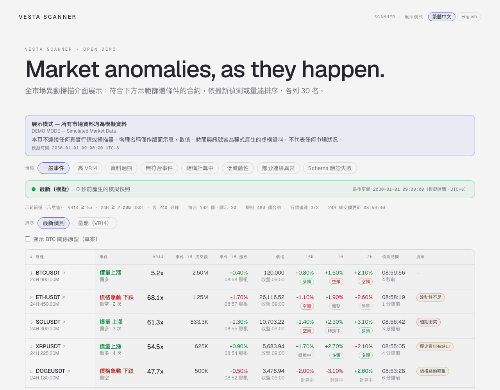
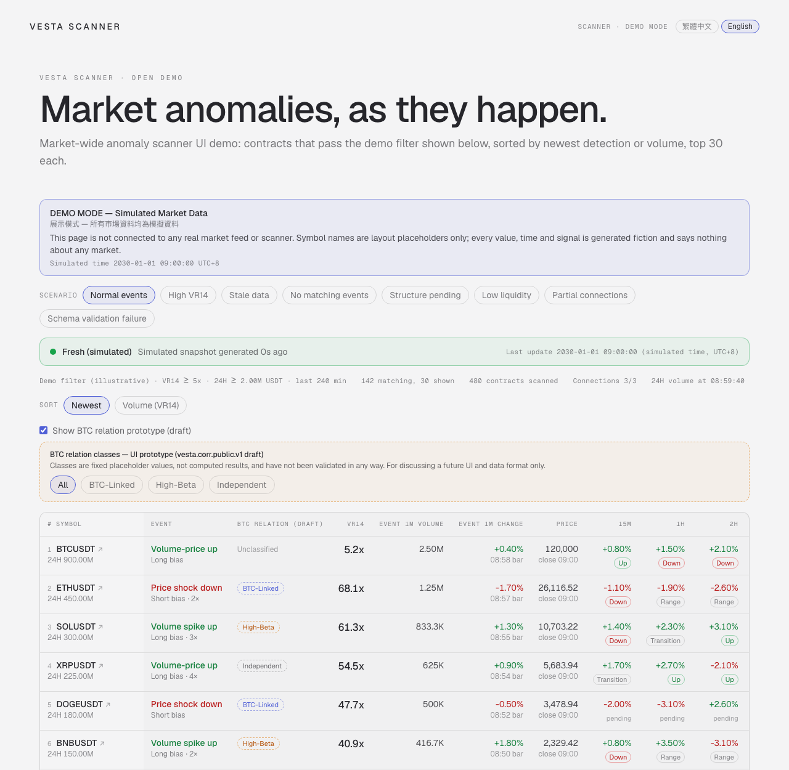
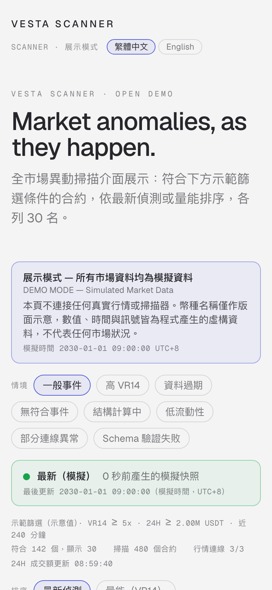

# VESTA Scanner Web

**Open-source frontend demo for crypto market monitoring — simulated data only.**
**加密貨幣市場監測的開源前端展示 — 僅使用模擬資料。**

[English](#english) · [繁體中文](#繁體中文) · [License](#license--授權)

> **DEMO MODE — Simulated Market Data.** Every number, time and signal in this project is fictional and generated by code. This is not investment advice, and the project contains no trading functionality.
>
> **展示模式 — 所有市場資料均為模擬資料。** 本專案中的數值、時間與訊號全部由程式產生、純屬虛構。不構成投資建議，也不含任何交易功能。



---

## English

### What this is

VESTA Scanner Web is a **mock-data-only demonstration** of the VESTA Scanner dashboard interface. It is **not** the production VESTA Scanner: it has no backend, no live market data and no detection algorithm, and it never connects to a VESTA service. It is released so developers, quantitative researchers and traders can study the interface, run it locally and propose ideas. It shows:

- **Volume-anomaly monitoring** — a ranked board of events by newest detection or by VR14, a relative-volume figure (how far the event's 1-minute volume exceeds recent typical volume)
- **Multi-timeframe market structure** — 15M / 1H / 2H trend states and timeframe-conflict hints
- **Event-driven dashboard states** — fresh, delayed, partial, stopped, offline and empty states, decided from the data's age and health
- **Responsive UI** — desktop and phone layouts; the wide table scrolls inside its own box
- **Progressive Web App** — installable, with an offline page that never shows stale market data
- **Mock market scenarios** — eight reproducible scenarios, including one that deliberately fails schema validation
- **BTC relationship prototype** — an optional, clearly labelled UI draft for future research (placeholder values, see [docs/BTC_RELATIONSHIPS.md](docs/BTC_RELATIONSHIPS.md))

### Current status

| | Status |
|---|---|
| Production VESTA Scanner | A separate, private system. Not part of this repository; nothing here connects to it |
| This repository | Public frontend demonstration; runs locally on **mock data only** |
| Data | **Mock only.** Generated by code — once at build time for the first render, then in the browser — at a simulated time starting 2030-01-01 09:00 (UTC+8) |
| BTC relationship classes | **Research proposal.** UI prototype with fixed placeholder values; no classification method is implemented or validated |

**Illustrative values only.** All thresholds, time windows and data-quality flags in this demo (for example the VR14 minimum, the 24H volume minimum and the time window shown in the filter line) are synthetic example values chosen for the mock data. They are **not** authoritative production VESTA Scanner settings and should not be read as a description of how the production Scanner works.

### Quick start

Requirements: Node.js **22.18 or newer** (needed to run the TypeScript tests natively) and npm.

```bash
npm install          # install dependencies
npm run dev          # development server → http://localhost:3210/demo
```

| Command | What it does |
|---|---|
| `npm run dev` | Development server on port 3210 |
| `npm run typecheck` | TypeScript check (`tsc --noEmit`) |
| `npm run lint` | ESLint |
| `npm test` | All tests (Node.js built-in test runner) |
| `npm run scan:security` | Local scan for secrets, private hosts, network calls and deployment files |
| `npm run build` | Production build |
| `npm start` | Serve the production build on port 3210 |
| `npm run check` | typecheck → lint → test → security scan → build |

No environment variables or secrets are needed. To keep Next.js from sending anonymous usage data, set `NEXT_TELEMETRY_DISABLED=1`.

URL parameters: `?scenario=` one of `normal`, `high_vr14`, `stale`, `empty`, `pending`, `low_liquidity`, `partial`, `invalid`; `?lang=` `zh-Hant` or `en`. Both can also be switched in the UI.

> The service worker registers only in production builds (`npm run build && npm start`), so PWA install and offline behaviour can be tried there, not in `npm run dev`.

### Architecture

```
Browser
  └─ /demo  (Next.js page, statically rendered)
       └─ ScannerBoard (components/)
            ├─ i18n dictionary ............ lib/i18n/
            └─ ScannerDataAdapter ......... lib/data/adapter.ts
                 └─ Mock adapter .......... lib/data/mock-adapter.ts
                      ├─ Simulated clock .. lib/data/sim-clock.ts
                      ├─ Mock scenarios ... lib/mock/scenarios.ts
                      └─ Schema check ..... lib/schema/public-v2.ts  (vesta.scan.public.v2)
```

Components only read data through the adapter, and every snapshot must pass the public schema before it is shown. **No production backend, database, data pipeline, detection algorithm or trading system is included.** Details: [docs/ARCHITECTURE.md](docs/ARCHITECTURE.md).

### Screenshots

| English, BTC relationship prototype on | Phone (390 px) |
|---|---|
|  |  |

All screenshots show simulated data from this repository.

### Disclaimer

This project is an educational and research demonstration. All market data is simulated. Nothing in it is financial or investment advice, a recommendation, or an entry/exit signal. It has no order, account or trade-execution functionality. Crypto derivatives are highly volatile.

### Collaborating

Ideas from developers, traders and researchers are welcome:

1. **Ideas and research questions** → [open an Issue](https://github.com/vestainsight-dotcom/vesta-scanner-web/issues/new/choose) with the Feature request or Research proposal template. GitHub Discussions are not enabled yet; the planned categories are in [docs/COMMUNITY.md](docs/COMMUNITY.md)
2. **Bugs and agreed features** → Issues, using the templates
3. **Code** → read [CONTRIBUTING.md](CONTRIBUTING.md); starter tasks are in [docs/GOOD_FIRST_ISSUES.md](docs/GOOD_FIRST_ISSUES.md)

Where the project is heading: [docs/ROADMAP.md](docs/ROADMAP.md). Security reports: [SECURITY.md](SECURITY.md). Community standards: [CODE_OF_CONDUCT.md](CODE_OF_CONDUCT.md).

---

## 繁體中文

### 專案簡介

VESTA Scanner Web 是 VESTA Scanner 儀表板介面的**純模擬資料展示**，**不是** VESTA Scanner 正式版：不含後端、即時行情或偵測演算法，也不會連線到任何 VESTA 服務。開放給開發者、量化研究者與交易員研究介面、在本機執行並提出想法。內容包括：

- **成交量異常監測**：依最新偵測或 VR14（相對成交量：事件那根 1 分鐘成交額相對近期一般成交量的倍數）排序的事件排行
- **多週期市場結構**：15M／1H／2H 趨勢狀態與週期衝突提示
- **事件驅動的儀表板狀態**：依資料新舊與健康狀態顯示最新、延遲、部分異常、停止、離線、無資料
- **響應式介面**：桌機與手機版面，寬表格在自身框內捲動
- **PWA**：可安裝；離線時顯示離線頁，不顯示過期行情
- **模擬市場情境**：八種可重現情境，其中一種刻意無法通過 schema 驗證
- **BTC 關係原型**：可開關、清楚標示的未來研究介面草案（示意值，見 [docs/BTC_RELATIONSHIPS.md](docs/BTC_RELATIONSHIPS.md)）

### 目前狀態

| | 狀態 |
|---|---|
| VESTA Scanner 正式版 | 獨立的私有系統，不在本儲存庫中，本專案也不會連線到它 |
| 本儲存庫 | 公開前端展示；在本機**僅以模擬資料**執行 |
| 資料 | **僅模擬資料**，由程式產生（首次畫面於建置時產生，之後在瀏覽器中產生），使用從 2030-01-01 09:00（UTC+8）開始的模擬時間 |
| BTC 關係分類 | **研究提案**。介面原型使用固定示意值，沒有實作或驗證任何分類方法 |

**所有數值僅為示意。** 本展示中的門檻、時間視窗與資料品質標記（例如篩選列顯示的 VR14 下限、24H 成交額下限與時間視窗）都是為模擬資料設定的合成範例值，**不是** VESTA Scanner 正式版的權威設定，也不代表正式版的運作方式。

### 快速開始

需求：Node.js **22.18 以上**（原生執行 TypeScript 測試所需）與 npm。

```bash
npm install          # 安裝相依套件
npm run dev          # 開發伺服器 → http://localhost:3210/demo
```

其他指令：`npm run typecheck`（型別檢查）、`npm run lint`、`npm test`（全部測試）、`npm run scan:security`（本機安全掃描）、`npm run build`（正式建置）、`npm start`（在 3210 埠提供正式建置）、`npm run check`（依序執行型別檢查、lint、測試、安全掃描與建置）。

不需要任何環境變數或 secret。若不希望 Next.js 傳送匿名使用資料，請設定 `NEXT_TELEMETRY_DISABLED=1`。

網址參數：`?scenario=`（`normal`、`high_vr14`、`stale`、`empty`、`pending`、`low_liquidity`、`partial`、`invalid`）與 `?lang=`（`zh-Hant`、`en`），也可直接在介面上切換。

> Service Worker 只在正式建置（`npm run build && npm start`）中註冊，PWA 安裝與離線行為請在正式建置中測試。

### 架構

頁面元件只透過 Data Adapter 取得資料，每份快照必須先通過公開 schema（`vesta.scan.public.v2`）驗證才會顯示。**本專案不包含正式後端、資料庫、資料管線、偵測演算法或任何交易系統。** 詳見 [docs/ARCHITECTURE.md](docs/ARCHITECTURE.md)。

### 截圖

| 英文介面，開啟 BTC 關係原型 | 手機（390 px） |
|---|---|
|  |  |

所有截圖皆為本儲存庫的模擬資料。

### 免責聲明

本專案僅供教育與研究展示，所有市場資料均為模擬資料，不構成任何財務或投資建議、推薦或進出場訊號，也不具備下單、帳戶或交易執行功能。加密貨幣衍生性商品波動劇烈。

### 參與協作

1. **想法與研究問題** → 以 Feature request 或 Research proposal 範本[開 Issue](https://github.com/vestainsight-dotcom/vesta-scanner-web/issues/new/choose)。GitHub Discussions 尚未啟用，預計的分類見 [docs/COMMUNITY.md](docs/COMMUNITY.md)
2. **錯誤回報與已確認的功能** → 使用範本開 Issue
3. **程式碼** → 請先讀 [CONTRIBUTING.md](CONTRIBUTING.md)；入門任務見 [docs/GOOD_FIRST_ISSUES.md](docs/GOOD_FIRST_ISSUES.md)

發展方向見 [docs/ROADMAP.md](docs/ROADMAP.md)；安全回報見 [SECURITY.md](SECURITY.md)；社群規範見 [CODE_OF_CONDUCT.md](CODE_OF_CONDUCT.md)。

---

## License / 授權

Copyright 2026 VESTA Lab. Source code and documentation are licensed under the [Apache License 2.0](LICENSE); see also [NOTICE](NOTICE).

VESTA and VESTA Lab names, logos, app icons and brand artwork are **not** covered by the Apache License — see [docs/BRANDING.md](docs/BRANDING.md). Third-party software keeps its own licenses — see [docs/THIRD_PARTY.md](docs/THIRD_PARTY.md).

原始碼與文件依 [Apache License 2.0](LICENSE) 授權。VESTA／VESTA Lab 名稱、標誌、App 圖示與品牌美術**不在**授權範圍內，詳見 [docs/BRANDING.md](docs/BRANDING.md)。
